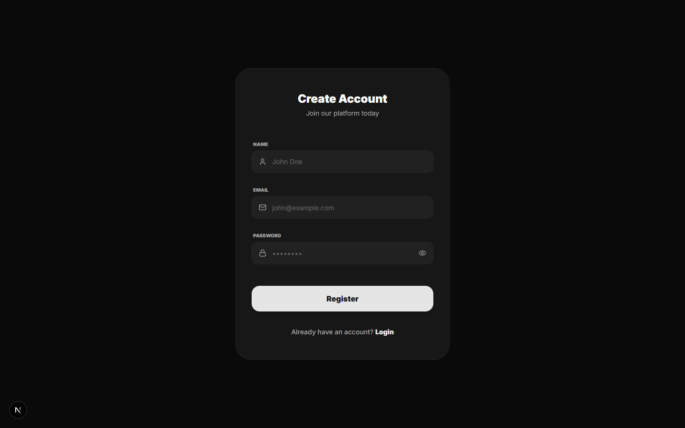
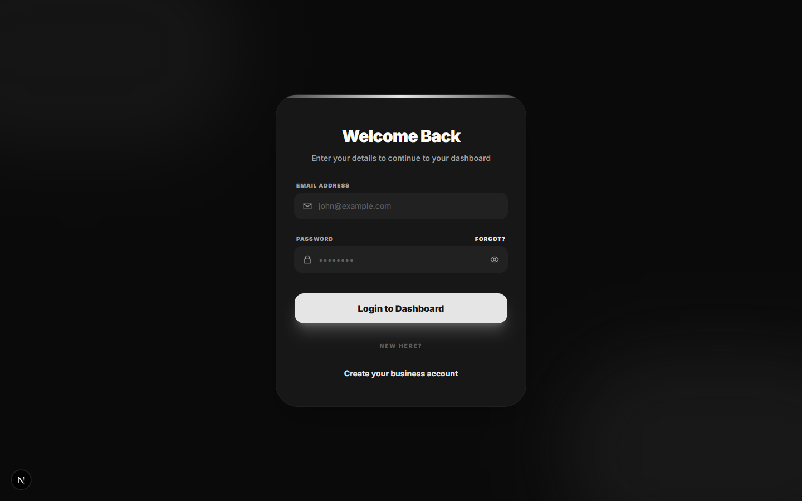
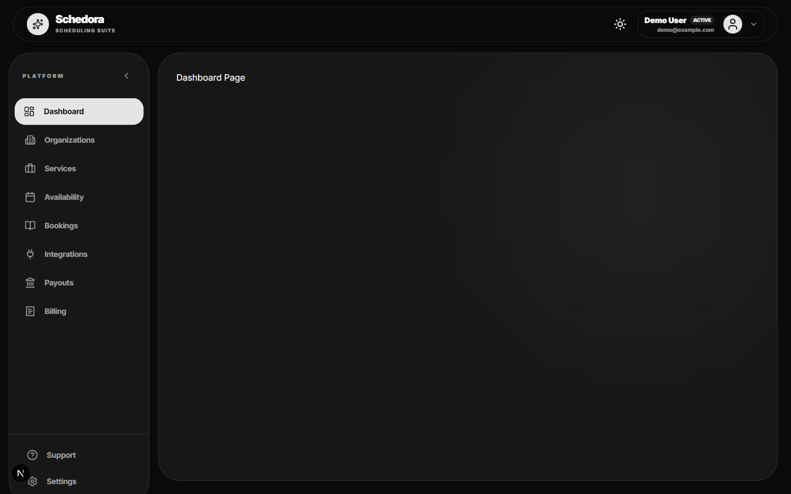
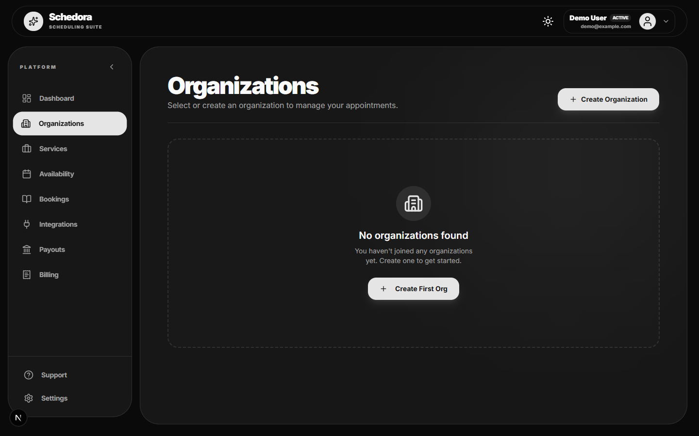
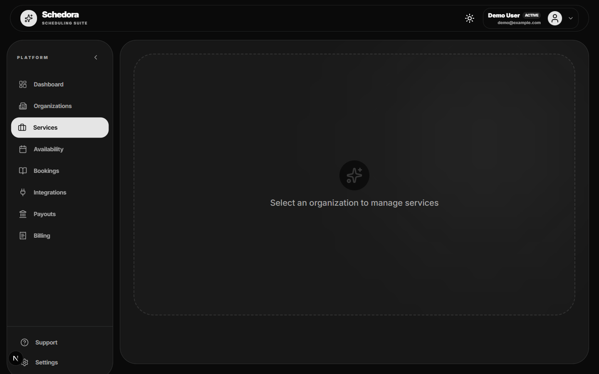
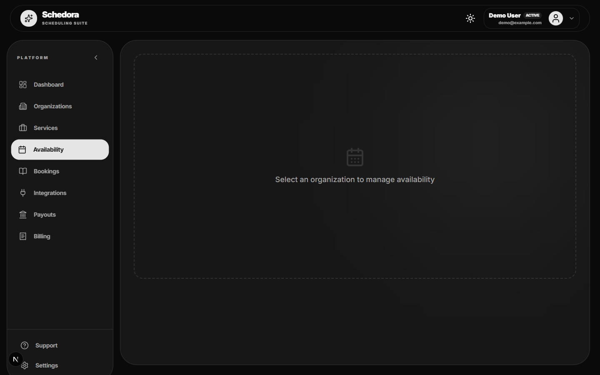
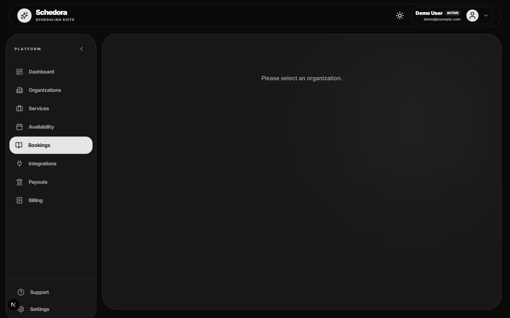

# Schedora – Appointment Booking SaaS

A full-stack appointment scheduling platform. Businesses create organizations, define services and availability, and share a public booking page with customers. Payments go through Razorpay, and bookings can sync to Google Calendar.

## Tech stack

| Layer    | Stack |
|----------|-------|
| Frontend | Next.js 16, React 19, Tailwind CSS 4, shadcn/ui, Redux Toolkit, React Hook Form + Zod |
| Backend  | Node.js, Express 5, TypeScript, Prisma 7 (PostgreSQL), BullMQ + Redis, JWT auth |
| Integrations | Razorpay (payments/subscriptions), Google Calendar, Resend (email) |

## Screenshots

### Landing page


### Register


### Login


### Dashboard


### Organizations


### Services


### Availability


### Bookings


## Running locally

### Prerequisites
- Node.js 20+
- PostgreSQL
- Redis on `127.0.0.1:6379`

Quick start for the databases with Docker:

```bash
docker run -d --name apptbook-redis -p 6379:6379 redis:7-alpine
docker run -d --name apptbook-pg -p 5433:5432 -e POSTGRES_PASSWORD=postgres -e POSTGRES_DB=appointmentbookingsaas postgres:16-alpine
```

### Backend

```bash
cd backend
cp .env.sample .env      # then fill in the values (see below)
npm install
npx prisma migrate deploy
npx prisma generate
npm run dev              # API server
npm run worker           # email queue worker (separate terminal)
```

Notes on `.env`:
- `ENCRYPTION_KEY` must be a 64-character hex string (32 bytes): `node -e "console.log(require('crypto').randomBytes(32).toString('hex'))"`
- `JWT_ACCESSTOKEN_EXPIRY` / `JWT_REFRESHTOKEN_EXPIRY` take values like `1d` and `7d`
- `CORS_ORIGINS` must match the frontend URL

### Frontend

Create `frontend/.env`:

```env
NEXT_PUBLIC_BACKEND_API_URL="http://localhost:4000/api/v1"
NEXT_PUBLIC_RAZORPAY_API_KEY="your_razorpay_key"
```

```bash
cd frontend
npm install
npm run dev
```

Open http://localhost:3000.
